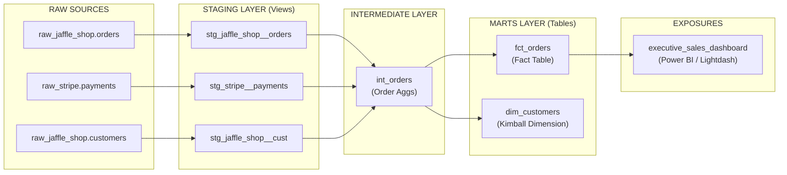

# 🥪 Enterprise Analytics Engineering Portfolio: Jaffle Shop

[](https://github.com/CodePerfectionist-V/analytics-engineering-portfolio/actions/workflows/dbt_ci.yml)
[](https://www.getdbt.com/)
[](https://cloud.google.com/bigquery)
[](https://opensource.org/licenses/MIT)

An enterprise-grade, end-to-end analytics engineering pipeline transforming raw transactional e-commerce data into clean, tested, and business-ready Kimball dimensional models using **dbt Core** and **Google BigQuery**.

---

## 📌 Business Case & Executive Summary
Raw e-commerce transaction logs often contain fragmented payment states, duplicate customer touchpoints, and unstandardized monetary amounts. This project implements a modern data stack pipeline to:
- Centralize transactional logic into standardized, reusable data models.
- Eliminate metric drift between marketing, sales, and executive reporting.
- Guarantee data trust through automated CI/CD quality assertions before code enters production.

---

## 🏗️ Architecture & Data Lineage (The Modular Approach)

The project follows a strict multi-layer Directed Acyclic Graph (DAG) architecture to enforce separation of concerns, optimize BigQuery compute usage, and support enterprise scalability.



1. **Staging Layer (`models/staging/`)**
   - **Purpose**: Clean, standardize, and rename raw source columns to conform to standard enterprise naming conventions (`snake_case`).
   - **Materialization**: `view`
   - **Models**: `stg_jaffle_shop__orders`, `stg_jaffle_shop__customers`, `stg_stripe__payments`

2. **Intermediate Layer (`models/intermediate/`)**
   - **Purpose**: Perform complex business aggregations (e.g., pivoting payment methods, calculating total successful order amounts) prior to dimensional modeling.
   - **Materialization**: `view`
   - **Models**: `int_orders`

3. **Marts Layer (`models/marts/core/`)**
   - **Purpose**: Serve high-performance Kimball star schema models optimized for downstream BI and executive analytics.
   - **Materialization**: `table`
   - **Models**:
     - `fct_orders`: Order-grain fact table capturing transaction totals, payment statuses, and customer keys.
     - `dim_customers`: Customer dimension capturing lifetime value (LTV), first/most recent order dates, and total order counts.

---

## 🛡️ Data Quality, Governance & CI/CD
- **11 Automated Data Tests**: Primary key uniqueness, missing value assertions (`not_null`), and foreign key referential integrity (`relationships`) enforced across all staging and mart models.
- **Automated GitHub Actions CI/CD (`dbt_ci.yml`)**: Every pull request triggers an automated dry run in an isolated BigQuery CI schema (`dbt run` and `dbt test`).
- **Branch Governance**: Protected `main` branch rules prevent direct code commits and require passing status checks prior to merging.
- **Downstream Lineage Governance (`exposures.yml`)**: Explicitly links analytical output models to the downstream `executive_sales_dashboard`.

---

## 🧰 Tech Stack
- **Data Warehouse**: Google BigQuery
- **Transformation Engine**: dbt Core (v1.12.5) with `dbt-bigquery` adapter
- **Orchestration & CI/CD**: GitHub Actions & GCP Service Account IAM
- **IDE & Local Dev**: VS Code ("Power User for dbt" extension), Windows PowerShell, Python venv
- **Version Control**: Git & GitHub

---

## ⚙️ Quickstart & Local Execution

### Prerequisites
- Python 3.10 or higher
- Google BigQuery Service Account JSON credentials

### Step-by-Step Setup

1. **Clone the repository:**
   ```powershell
   git clone https://github.com/CodePerfectionist-V/analytics-engineering-portfolio.git
   cd analytics-engineering-portfolio\ae_jaffle_shop
   ```

2. **Activate the Virtual Environment:**
   ```powershell
   .\venv\Scripts\Activate.ps1
   ```

3. **Install Dependencies:**
   ```powershell
   pip install dbt-core dbt-bigquery
   ```

4. **Execute Data Pipeline:**
   ```powershell
   # Seed source lookup data
   dbt seed

   # Run all transformation models
   dbt run

   # Execute all 11 schema assertions
   dbt test
   ```

5. **Generate and View Interactive Lineage Docs:**
   ```powershell
   dbt docs generate
   dbt docs serve
   ```
   Open `http://localhost:8080` in your browser to inspect the interactive DAG and column metadata catalog.